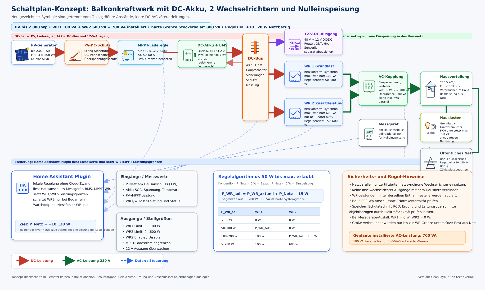

# BKW Effizienz steigern

Konzept und Home-Assistant-Regelung fuer ein Balkonkraftwerk mit DC-Speicher, zwei netzparallelen Wechselrichtern und Nulleinspeisungsregelung.

Ziel des Projekts: geringe Grundlast effizient versorgen und Zusatzleistung nur bei Bedarf zuschalten.



## Eckdaten des Zielsystems

| Bereich | Auslegung |
|---|---:|
| PV-Leistung | bis 2.000 Wp |
| DC-Akku | 48 V / 51,2 V LiFePO4, Beispiel 4,8 kWh |
| WR 1 Grundlast | 100 VA, Regelbereich ca. 50 bis 100 W |
| WR 2 Zusatzleistung | 600 VA, Regelbereich ca. 50 bis 600 W |
| Installierte WR-Summe | 700 VA |
| Rechtlicher Grenzwert Steckersolar DE | maximal 800 VA |
| Grosse Verbraucher | werden nur bis zur WR-Grenze unterstuetzt, Rest kommt aus dem Netz |
| Regelung | Home Assistant + Messgeraet am Hausanschluss |
| 12 V DC | Router, ONT, Smart Home, Home Assistant, Sensorik |

## Warum zwei Wechselrichter?

Viele Batteriewechselrichter haben bei niedriger Last hohe Grundverluste. Das Konzept trennt deshalb:

1. WR 1 laeuft fuer die Grundlast und wird in seinem guenstigen Leistungsbereich betrieben.
2. WR 2 wird erst bei hoeherer Hauslast zugeschaltet.
3. Der 12-V-DC-Ausgang vermeidet unnoetige DC-AC-DC-Wandlung fuer Router und Kleingeraete.

<br>
<a href="https://www.buymeacoffee.com/thoralf.brandt" target="_blank">
  
</a>
<br>

## Repo-Inhalt

```text
docs/                         Konzept, Recht, Regelalgorithmus, Installation
hardware/                     Einkaufsliste und Preisnotizen
home-assistant/               Blueprints, Beispielkonfiguration, Dashboard
custom_components/            HACS-faehige Service-Integration
src/                          Reiner Python-Regelalgorithmus
tests/                        Unit-Tests fuer den Regler
scripts/                      Hilfsskripte
```

## Home Assistant Schnellstart

1. Blueprint importieren: `home-assistant/blueprints/automation/bkw_effizienz_steigern/nulleinspeisung_2wr.yaml`
2. Sensor fuer Hausanschlussleistung eintragen, z. B. Shelly Pro 3EM.
3. Entitaeten fuer WR1/WR2-Leistungsgrenzen und WR1/WR2-Schalter zuordnen.
4. Zielwert auf kleinen positiven Netzbezug stellen, z. B. `+15 W`.
5. Akku-SOC-Schwelle pruefen, z. B. Stop bei 20 %, Resume bei 25 %.

Details: [docs/home-assistant.md](docs/home-assistant.md)

## Wichtige Hinweise

Dieses Repository ist ein Konzept, kein montagefertiger Installationsplan. Arbeiten an 230 V, Anschluss an das oeffentliche Stromnetz, Schutzorgane, Erdung, RCD, Leitungsquerschnitte und Inbetriebnahme muessen objektbezogen durch eine Elektrofachkraft geprueft werden.

Bei Steckersolargeraeten in Deutschland sind die jeweils aktuellen Regeln zu beachten. Insbesondere zaehlt fuer die 800-VA-Grenze die maximal waehlebare Wechselrichterleistung, nicht nur eine App-Drosselung.

## Lizenz

Dieses Repository steht unter der MIT-Lizenz. Siehe [LICENSE](LICENSE).
