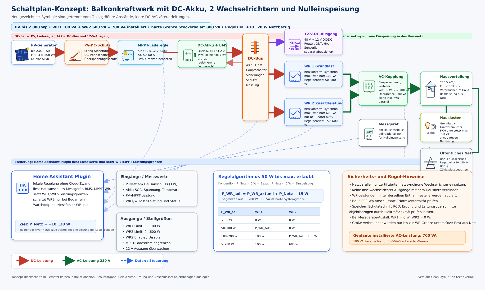

# BKW Efficiency Booster

[🇩🇪 Deutsch](README.md) · 🇬🇧 English

Concept and Home Assistant control for a balcony power plant (German "Balkonkraftwerk") with DC storage, two grid-tied inverters and zero-export control.

Goal of the project: supply a small base load efficiently and add extra power only when needed.



## Target system at a glance

| Area | Design |
|---|---:|
| PV power | up to 2,000 Wp |
| DC battery | 48 V / 51.2 V LiFePO4, e.g. 4.8 kWh |
| Inverter 1 – base load | 100 VA, control range approx. 50 to 100 W |
| Inverter 2 – extra power | 600 VA, control range approx. 50 to 600 W |
| Total installed inverter power | 700 VA |
| Legal limit for plug-in solar in Germany | max. 800 VA |
| Large loads | supported only up to the inverter limit, the rest comes from the grid |
| Control | Home Assistant + power meter at the grid connection |
| 12 V DC | router, ONT, smart home, Home Assistant, sensors |

## Why two inverters?

Many battery inverters have high standby losses at low load. The concept therefore separates:

1. Inverter 1 runs for the base load and is operated in its efficient power range.
2. Inverter 2 is only switched on at higher household load.
3. The 12 V DC output avoids unnecessary DC-AC-DC conversion for the router and small devices.

<br>
<a href="https://www.buymeacoffee.com/thoralf.brandt" target="_blank">
  
</a>
<br>

## Summary

An open-source concept for improving the efficiency of German balcony PV storage systems.  
The system uses a small 100 VA inverter for continuous base loads and switches an additional 600 VA inverter only when needed. A DC battery, MPPT charger, grid power meter and Home Assistant controller work together to reduce low-load inverter losses and support zero-export operation within the German 800 VA balcony solar limit.

This project is intended for concept development, documentation and experimentation. Electrical installation must be checked and carried out according to local regulations by qualified professionals.

## Repository contents

```text
docs/                         Concept, legal notes, control algorithm, installation
hardware/                     Shopping list and price notes
home-assistant/               Blueprints, example configuration, dashboard
custom_components/            HACS-compatible service integration
src/                          Pure Python control algorithm
tests/                        Unit tests for the controller
scripts/                      Helper scripts
```

> The documentation in `docs/` is written in German.

## Home Assistant quick start

1. Import the blueprint: `home-assistant/blueprints/automation/bkw_effizienz_steigern/nulleinspeisung_2wr.yaml`
2. Enter the sensor for the grid connection power, e.g. Shelly Pro 3EM.
3. Assign the entities for the inverter 1/2 power limits and the inverter 1/2 switches.
4. Set the target to a small positive grid draw, e.g. `+15 W`.
5. Check the battery SOC thresholds, e.g. stop at 20 %, resume at 25 %.

Details: [docs/home-assistant.md](docs/home-assistant.md)

## Important notes

This repository is a concept, not a ready-to-install installation plan. Work on 230 V, connection to the public grid, protective devices, earthing, RCD, cable cross-sections and commissioning must be checked on site by a qualified electrician.

For plug-in solar devices in Germany, the current rules apply. In particular, the 800 VA limit refers to the maximum selectable inverter power, not just a throttle set in an app.

## License

This repository is licensed under the MIT License. See [LICENSE](LICENSE).
