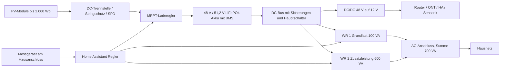

# Konzept

## Ziel

Das System soll die Effizienz eines Balkonkraftwerkspeichers bei geringer Last verbessern. Statt einen grossen Batteriewechselrichter dauerhaft im ineffizienten Teillastbereich zu betreiben, werden zwei Leistungsstufen eingesetzt:

- **WR 1 Grundlast:** 100 VA, aktiv bei ca. 50 bis 100 W.
- **WR 2 Zusatzleistung:** 600 VA, wird nur bei Bedarf zugeschaltet.

Die installierte Wechselrichterleistung betraegt damit 700 VA und bleibt unter der deutschen Steckersolar-Grenze von 800 VA.

## Systemuebersicht

## Betriebsarten

### 1. DC-Grundversorgung

Bei sehr geringer Hauslast bleiben beide 230-V-Wechselrichter aus oder WR1 wird auf 0 W begrenzt. Router, Glasfaser-ONT, Home Assistant und Sensorik werden ueber den 12-V-DC-Ausgang versorgt.

### 2. Grundlastbetrieb

Bei ca. 50 bis 100 W Last arbeitet nur WR1. Ziel ist ein kleiner positiver Netzbezug von z. B. 10 bis 20 W, um unerwuenschte Rueckeinspeisung durch Messrauschen zu vermeiden.

### 3. Zusatzlastbetrieb

Ab ca. 100 W Sollleistung wird WR2 zugeschaltet. WR1 bleibt bei bis zu 100 W, WR2 liefert den Rest bis maximal 600 W. Die Systemsumme bleibt bei 700 W/VA.

### 4. Grosse Verbraucher

Verbraucher oberhalb der BKW-Leistung werden nur anteilig unterstuetzt. Beispiel: Bei 1.400 W Hauslast liefern WR1+WR2 maximal 700 W, der Rest kommt aus dem Netz.

## Warum keine 2-kW-Zusatzstufe?

Als netzparallel angeschlossenes Steckersolargeraet gilt die 800-VA-Grenze. Ein groesserer Wechselrichter duerfte nicht einfach als Balkonkraftwerk an das Hausnetz angeschlossen werden. Eine echte Notstrom-/Inselversorgung kann separat geplant werden, darf aber nicht unsynchronisiert mit dem Hausnetz parallel verbunden werden.
